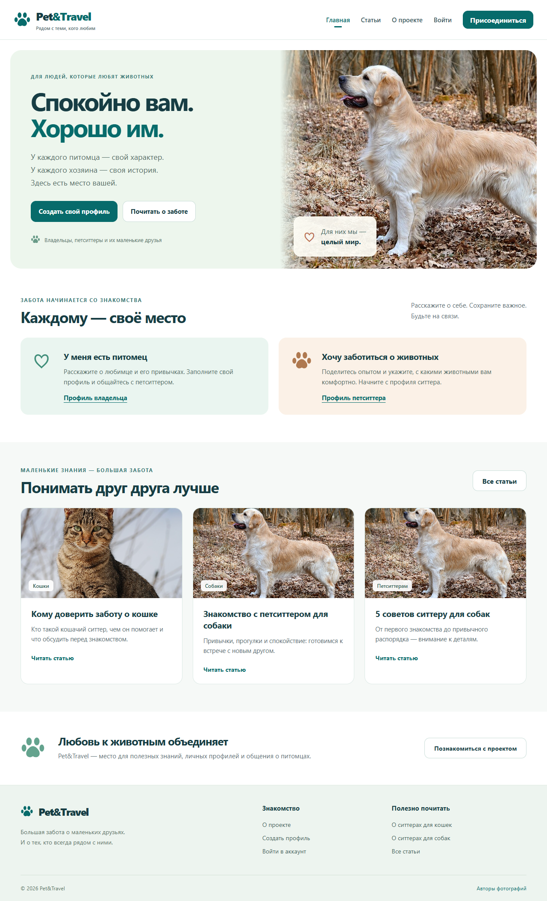
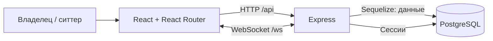

<div align="center">

<h1>🐾 Pet-Travel</h1>

<p><strong>Платформа о заботе о питомцах: владельцы животных, петситтеры, полезные материалы и общение.</strong></p>


</div>

---

## О проекте

Pet-Travel — веб-приложение для владельцев животных и петситтеров. Владелец может завести профиль и описать своих питомцев, а ситтер — рассказать о себе и о том, за какими животными готов присматривать. Для пользователей также предусмотрены статьи об уходе за кошками, собаками и другими питомцами.

Версия 2.0 связывает эти экраны с PostgreSQL: можно зарегистрироваться, заполнить профиль и общаться в личном чате. Основная рабочая версия находится в **[main](https://github.com/Andrew-Kotlov/Pet-Travel/tree/main)**, интеграционная — в **[develop](https://github.com/Andrew-Kotlov/Pet-Travel/tree/develop)**.



## Что работает

| Раздел | Возможности |
|---|---|
| 🔐 Аккаунт | Регистрация с ролью `parent` или `sitter`, вход, выход, восстановление сессии после перезапуска приложения |
| 👤 Профили | Редактирование своего профиля; у ситтера — опыт и виды животных, у владельца — описание дома и ухода |
| 🐶 Питомцы | Создание, просмотр, изменение и удаление своих питомцев владельцем; фотографии по HTTPS-ссылке |
| 💬 Чат | Диалог по ID пользователя, сообщения онлайн, сохранённая история и переподключение |
| 📚 Статьи | Девять исходных материалов, поиск по заголовку/описанию и фильтр по теме |
| 📱 Интерфейс | Адаптивная навигация, формы с ошибками, пустые состояния, 404, клавиатурный фокус |

ID для чата виден в профиле; пользователи обмениваются им самостоятельно. Каталог ситтеров, бронирования и платежи не реализованы. Модели отзывов и верификации сохранены, но API и экранов для них пока нет. [Подробная карта возможностей](docs/FEATURES.md).

## Локальный запуск

Нужны Node.js **24.22.3 LTS**, npm **11–12** и отдельная PostgreSQL **17**. Проверено с npm 12.2.3 и PostgreSQL 17.12. Создание локальных БД и команды для Ubuntu/WSL2 описаны в [DEVELOPMENT](docs/DEVELOPMENT.md).

```bash
git clone https://github.com/Andrew-Kotlov/Pet-Travel.git
cd Pet-Travel
npm ci
cp .env.example .env
# В .env задайте DATABASE_URL и собственный случайный SESSION_SECRET.
npm run db:migrate
npm run dev
```

Откройте [http://127.0.0.1:5173](http://127.0.0.1:5173). Vite отправляет `/api` и `/ws` на API `127.0.0.1:3001`. Frontend обновляется автоматически; после изменения backend перезапустите `npm run dev`.

Для проверки собранного приложения остановите dev-процессы:

```bash
npm run build
npm start
```

Откройте [http://127.0.0.1:3001](http://127.0.0.1:3001). `NODE_ENV=development` из примера подходит для локального HTTP; будущий production-режим требует HTTPS.

## Проверки

```bash
npm run lint
npm test
npm run build
# После настройки отдельной .env.test и БД с именем, оканчивающимся на _test:
npm run test:integration
npx playwright install chromium
npm run test:e2e
npm audit
```

Результат приёмки: **10 backend unit + 18 frontend + 21 интеграционных + 5 браузерных тестов прошли**. Интеграционные тесты используют настоящую PostgreSQL и собственные временные схемы. [Условия, результаты и границы проверки](docs/TESTING.md).

## Как устроено приложение



**Frontend:** React 19, Vite 8, React Router 7; состояние авторизации — React Context.

**Backend:** Node.js 24, Express 5, Sequelize 6, PostgreSQL, `ws`.

```text
Pet-Travel/
├── client/src/       # Экраны, навигация, статьи, стили, тесты
├── client/public/    # Локальные фотографии и сведения об их лицензиях
├── server/src/       # API, авторизация, WebSocket, мигратор, seed
├── server/db/        # Модели и 9 миграций
├── server/test/      # Unit, PostgreSQL, WebSocket, переход со старой схемы
├── e2e/              # Playwright + axe
├── scripts/          # Локальный запуск и проверка синтаксиса сервера
└── docs/             # Архитектура, приёмка и передача DevOps
```

[Архитектура и API](docs/ARCHITECTURE.md) · [Аудит исходной версии](docs/AUDIT.md) · [Правила веток](docs/BRANCHING.md) · [Передача DevOps](docs/DEVOPS_HANDOFF.md) · [История изменений](CHANGELOG.md) · [Задание](docs/CODEX_TASK.md)

## План развития

- [x] Объединить полезные изменения веток и сохранить историю.
- [x] Обновить зависимости и перейти с CRA на Vite.
- [x] Сделать адаптивный интерфейс для компьютера и телефона.
- [x] Доработать регистрацию, вход, профили и операции с питомцами.
- [x] Реализовать приватный WebSocket-чат с историей.
- [x] Добавить тесты, миграции и локальный запуск.
- [ ] Спроектировать реальные отзывы, верификацию и правила модерации.
- [ ] Добавить восстановление пароля и управление аккаунтом.
- [ ] Контейнеризация, CI/CD, развёртывание и мониторинг — следующая практика владельца проекта.

Код распространяется по [Apache-2.0](LICENSE). У фотографий отдельные [лицензии и авторы](client/public/photo-credits.html).
