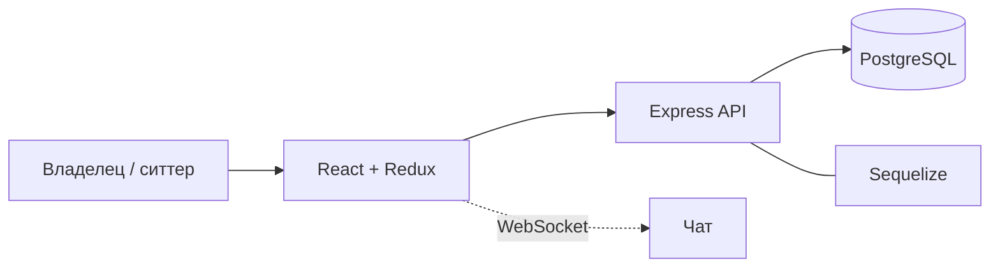

<div align="center">

<h1>🐾 Pet-Travel</h1>

<p><strong>Платформа о заботе о питомцах: владельцы животных, петситтеры, полезные материалы и общение.</strong></p>


</div>
---

## О проекте

Pet-Travel — веб-приложение для владельцев животных и петситтеров. Владелец может завести профиль и описать своих питомцев, а ситтер — рассказать о себе и о том, за какими животными готов присматривать. Для пользователей также предусмотрены статьи об уходе за кошками, собаками и другими питомцами.

Проект **развивается**: сейчас объединяем сделанные части приложения, дорабатываем экраны и связываем интерфейс с сервером.

## Что уже сделано

| Раздел | Что есть сейчас |
|---|---|
| 🔐 Регистрация | Форма с выбором роли: владелец (`parent`) или ситтер (`sitter`); серверный маршрут создания пользователя |
| 🐶 Питомцы | Модель с именем, возрастом, видом животного и фотографией |
| 👤 Профили | Модели владельца и петситтера, поля для описания, местоположения и фотографий |
| ⭐ Отзывы | Модели отзывов о ситтерах, владельцах и самом приложении |
| 💬 Чат | Первая реализация общения через WebSocket |
| 📚 Статьи | Девять материалов о питомцах, их поведении и уходе |

Вход в аккаунт, интерфейсы профилей и чат ещё дорабатываются. Поиск ситтеров, бронирование и оплата пока не реализованы.

## Как устроено приложение



**Frontend:** React, Redux, React Router.  
**Backend:** Node.js, Express, Sequelize, PostgreSQL, WebSocket.

### Где лежит код

Основная версия приложения сейчас находится в ветке **[dev](https://github.com/Andrew-Kotlov/Pet-Travel/tree/dev)**.

```text
Pet-Travel/
├── client/
│   └── src/
│       ├── components/    # Формы, статьи, меню, чат
│       └── store/         # Redux
└── server/
    ├── db/
    │   ├── migrations/    # Миграции базы данных
    │   └── models/        # Пользователи, питомцы, профили, отзывы
    ├── src/               # Express и маршруты
    └── ws.js              # WebSocket
```

[Маршруты React](https://github.com/Andrew-Kotlov/Pet-Travel/blob/dev/client/src/App.js) · [Модели базы данных](https://github.com/Andrew-Kotlov/Pet-Travel/tree/dev/server/db/models) · [Express-сервер](https://github.com/Andrew-Kotlov/Pet-Travel/blob/dev/server/src/index.js)

## План развития

- [ ] Привести в порядок ветки и собрать рабочую версию приложения.
- [ ] Обновить библиотеки frontend и backend.
- [ ] Сделать современный адаптивный интерфейс для компьютера и телефона.
- [ ] Доработать регистрацию, вход и личные профили.
- [ ] Подключить отображение питомцев и отзывов к данным из базы.
- [ ] Исправить чат и обмен сообщениями через WebSocket.
- [ ] Добавить тесты и понятную инструкцию по локальному запуску.
- [ ] Контейнеризировать приложение, настроить CI/CD, развёртывание и мониторинг.
