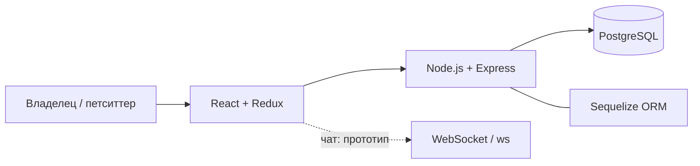

<div align="center">

<h1>🐾 Pet-Travel</h1>

<p><strong>Платформа о заботе о питомцах: владельцы животных, петситтеры, полезные материалы и общение.</strong></p>


</div>

---

## 💡 Идея проекта

**Pet-Travel (Pet&Travel)** — учебный full-stack проект, задуманный как пространство, где **владельцы домашних животных** и **петситтеры** могут взаимодействовать, а пользователи — читать советы по уходу за питомцами.

У приложения две роли:

- 🐕 **Владелец питомца** (`parent`) — пользователь, который может описать себя и своих животных.
- 🧑‍🦰 **Петситтер** (`sitter`) — специалист по присмотру за животными со своим профилем.

> **Текущее состояние:** проект находится на стадии прототипа. Основные исходники сейчас лежат в ветке **[dev](https://github.com/Andrew-Kotlov/Pet-Travel/tree/dev)**. Ветка `main` пока содержит только базовые файлы репозитория. Многие модели данных существуют, но соответствующие пользовательские экраны ещё не реализованы.

## 🧩 Что уже есть в исходниках

| Компонент | Состояние по ветке `dev` |
|---|---|
| 🔐 Регистрация | Форма с выбором роли «Владелец» / «Ситтер», серверный обработчик регистрации |
| 🔑 Вход | Форма интерфейса, логика входа ещё требует реализации |
| 🐶 Питомцы | Sequelize-модель с именем, возрастом, типом и фотографией |
| 👤 Профили | Модели владельца и ситтера, поля описания и фотографий; интерфейсы неполные |
| ⭐ Отзывы | Модели отзывов о владельцах, ситтерах и приложении |
| 💬 Общение | Экспериментальный WebSocket-чат, требуется исправление |
| 📚 Статьи | Девять страниц с материалами о кошках, собаках, птицах и уходе |

В прототипе пока **нет подтверждённой реализации** полноценного поиска петситтеров, бронирования, календаря доступности, оплаты или отслеживания поездок. Эти возможности не следует считать работающими.

## 🏗️ Текущая техническая основа



Схема построена по структуре исходников; она **не подтверждает**, что все компоненты успешно запускаются вместе.

### Структура ветки `dev`

```text
Pet-Travel/
├── client/            # React, маршруты, статьи, формы и чат
│   └── src/
│       ├── components/
│       └── store/
└── server/            # Express, PostgreSQL, Sequelize и WebSocket
    ├── db/
    │   ├── migrations/
    │   └── models/
    ├── src/
    └── ws.js
```

**Изучить код:** [страницы и маршруты React](https://github.com/Andrew-Kotlov/Pet-Travel/blob/dev/client/src/App.js) · [модели данных](https://github.com/Andrew-Kotlov/Pet-Travel/tree/dev/server/db/models) · [сервер Express](https://github.com/Andrew-Kotlov/Pet-Travel/blob/dev/server/src/index.js)

## 🎯 Следующий этап — обновление приложения

План развития проекта:

- [ ] Проанализировать существующие ветки и объединить полезный код без потери истории.
- [ ] Обновить зависимости и привести frontend/backend к поддерживаемым версиям.
- [ ] Переработать интерфейс под современные desktop и mobile-экраны.
- [ ] Исправить авторизацию, маршруты и WebSocket-чат.
- [ ] Написать тесты и документацию по локальному запуску.
- [ ] Подготовить понятный технический handoff для DevOps-практики.

Развитие приложения планируется с помощью **Codex в роли разработчика**. Самостоятельная DevOps-практика будет отдельным этапом: контейнеризация, CI/CD, развёртывание, мониторинг и эксплуатация. Эти этапы **ещё не выполнены**.

## 🔎 Зачем сохраняем проект

Pet-Travel сочетает frontend, API, реляционную БД и обмен сообщениями — хорошая основа, чтобы пройти полный путь приложения от исходного кода до управляемого развёртывания, не выдавая прототип за готовый продукт.

---

<p align="center"><sub>Pet-Travel · Full-stack prototype → DevOps practice project</sub></p>
